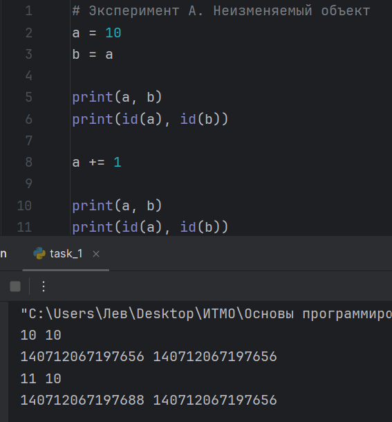
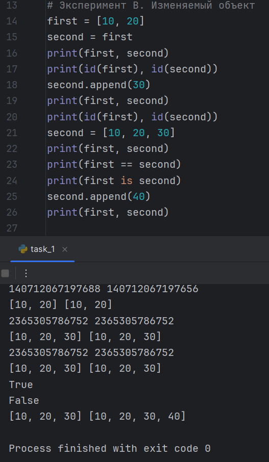

### Задание 1. Имена, ссылки и изменяемость
Целые числа в Python относятся к неизменяемым объектам. Это означает, что после создания объекта его значение нельзя изменить. Python вычисляет результат сложения 10 + 1 и связывает имя a с результатом 11. Объект, представляющий число 10, при этом не изменяется, поэтому имя b продолжает обозначать значение 10.
Таким образом, операция a += 1 не изменяет значение, доступное через b, поскольку она не изменяет исходный объект, а приводит к переназначению имени a.


После выполнения second = first оба имени ссылаются на один список. Метод append() изменяет существующий список, поэтому добавление элемента через second отражается и при обращении через first.

После выполнения second = [10, 20, 30] создаётся новый список, с которым связывается имя second. Исходный список остаётся связанным с именем first.

Оператор == проверяет равенство значений, а оператор is проверяет идентичность объектов. Поэтому для двух списков с одинаковым содержимым first == second возвращает True, а first is second возвращает False.

После добавления числа 40 в новый список исходный список не изменяется.


**Схемы связей между именами и объектами**
```
До переназначения second:
first ──────┐
            ├──> [10, 20, 30]
second ─────┘

После переназначения second:

first ─────────> [10, 20, 30]

second ────────> [10, 20, 30]
                 другой объект
```
**Практическая задача**
<details>
<summary><b>Код практической задачи (нажмите, чтобы развернуть)</b></summary>

```python
config1 = ["Проект", ["Петр","Иван"],[8080, 0]]
# Создание с помощью присваивание
config2 = config1

print("До изменений:")
print("config1 =", config1)
print("config2 =", config2)

config2[1].append("Пётр")
config2[2][0] = 9000

print("\nПосле изменения config2:")
print("config1 =", config1)
print("config2 =", config2)

# Создание независимой конфигурации
config3 = ["Проект", ["Петр","Иван"],[8080, 0]]
config1[1].append("Мария")
config1[2][0] = 9000
assert config1 is not config3
assert config1[1] is not config3[1]
assert config1[2] is not config3[2]

assert "Мария" not in config3[1]
assert config1[2][0] == 9000
assert config3[2][0] == 8080
print("\nПервая конфигурация (зависимая с сonfig2):", config1)
print("Вторая (независимая)конфигурация:", config3)
```

</details>

<details>
<summary><b>Вывод программы (нажмите, чтобы развернуть)</b></summary>

```text
До изменений:
config1 = ['Проект', ['Петр', 'Иван'], [8080, 0]]
config2 = ['Проект', ['Петр', 'Иван'], [8080, 0]]

После изменения config2:
config1 = ['Проект', ['Петр', 'Иван', 'Пётр'], [9000, 0]]
config2 = ['Проект', ['Петр', 'Иван', 'Пётр'], [9000, 0]]

Первая конфигурация (зависимая с сonfig2): ['Проект', ['Петр', 'Иван', 'Пётр', 'Мария'], [9000, 0]]
Вторая (независимая)конфигурация: ['Проект', ['Петр', 'Иван'], [8080, 0]]
```

</details>

При создании `config2 = config1` обе переменные ссылаются на один и тот же список. Поэтому изменение вложенных списков через `config2` также отражается в `config1`. Это происходит потому, что присваивание не создаёт новую конфигурацию, а лишь создаёт дополнительную ссылку на существующий объект.

При создании `config3` с таким же наполнением формируется независимая конфигурация. Внешний список и вложенные списки имеют разные идентификаторы, поэтому изменение участников или параметров запуска в `config1` не влияет на `config3`.

Проверки `assert` подтверждают, что `config1` и `config3`, а также их вложенные списки являются разными объектами. Дополнительные проверки показывают, что изменение участников и параметров первой конфигурации не затрагивает вторую. Таким образом, обычное присваивание создаёт общую ссылку на объект, а создание нового списка с таким же наполнением обеспечивает независимость конфигураций.

**Ответы на вопросы для анализа**

1. Меняет ли присваивание second = first сам объект?

Нет. Присваивание связывает имя second с объектом, на который ссылается first. Сам объект не изменяется и не копируется.

2. Почему операция над неизменяемым объектом приводит к связыванию имени с другим объектом?

Неизменяемый объект нельзя изменить после создания. При выполнении a += 1 вычисляется результат сложения, после чего имя a связывается с результатом. Имя b продолжает ссылаться на исходный объект.

3. Как определить, что два имени обозначают один объект?

Для этого используется оператор is. Если выражение first is second возвращает True, оба имени ссылаются на один объект. Также можно сравнить результаты вызова id() для этих имён.

### Задание 2. Поверхностное и глубокое копирование

<details>
<summary><b>Код task_2 (нажмите, чтобы развернуть)</b></summary>

```python
import copy

# Функция для вывода содержимого всех списков
def status(original, alias, shallow, deep):
    print("original =", original)
    print("alias    =", alias)
    print("shallow  =", shallow)
    print("deep     =", deep)


# Функция для вывода идентификаторов внешних списков
def status_id(original, alias, shallow, deep):
    print("original:", id(original))
    print("alias:", id(alias))
    print("shallow:", id(shallow))
    print("deep:", id(deep))


# Функция для вывода идентификаторов первых вложенных списков
def status_id_nested_lists(original, alias, shallow, deep):
    print("original:", id(original[0]))
    print("alias:", id(alias[0]))
    print("shallow:", id(shallow[0]))
    print("deep:", id(deep[0]))


# Функция для вывода идентификаторов первых оценок
def status_id_first_grades(original, alias, shallow, deep):
    print("original:", id(original[0][1]))
    print("alias:", id(alias[0][1]))
    print("shallow:", id(shallow[0][1]))
    print("deep:", id(deep[0][1]))


# Создание исходного списка
original = [
    ["Python", 5],
    ["Algorithms", 4]
]

# Создание трех вариантов
alias = original
shallow = original.copy()
deep = copy.deepcopy(original)


# Состояние до изменений
print("=== До изменений ===")
status(original, alias, shallow, deep)

print("\nИдентификаторы внешних списков:")
status_id(original, alias, shallow, deep)

print("\nИдентификаторы первых вложенных списков:")
status_id_nested_lists(original, alias, shallow, deep)

print("\nИдентификаторы первых оценок:")
status_id_first_grades(original, alias, shallow, deep)


# Первое изменение
original.append(["Databases", 5])

print("\n=== После добавления Databases ===")
status(original, alias, shallow, deep)

print("\nИдентификаторы внешних списков:")
status_id(original, alias, shallow, deep)

print("\nИдентификаторы первых вложенных списков:")
status_id_nested_lists(original, alias, shallow, deep)

print("\nИдентификаторы первых оценок:")
status_id_first_grades(original, alias, shallow, deep)


# Второе изменение
original[0][1] = 3

print("\n=== После изменения оценки Python ===")
status(original, alias, shallow, deep)

print("\nИдентификаторы внешних списков:")
status_id(original, alias, shallow, deep)

print("\nИдентификаторы первых вложенных списков:")
status_id_nested_lists(original, alias, shallow, deep)

print("\nИдентификаторы первых оценок:")
status_id_first_grades(original, alias, shallow, deep)
```

</details>

<details>
<summary><b>Вывод программы (нажмите, чтобы развернуть)</b></summary>

```
=== До изменений ===
original = [['Python', 5], ['Algorithms', 4]]
alias    = [['Python', 5], ['Algorithms', 4]]
shallow  = [['Python', 5], ['Algorithms', 4]]
deep     = [['Python', 5], ['Algorithms', 4]]

Идентификаторы внешних списков:
original: 1898306250432
alias: 1898306250432
shallow: 1898309290624
deep: 1898309294272

Идентификаторы первых вложенных списков:
original: 1898305951936
alias: 1898305951936
shallow: 1898305951936
deep: 1898309294336

Идентификаторы первых оценок:
original: 140712067197496
alias: 140712067197496
shallow: 140712067197496
deep: 140712067197496

=== После добавления Databases ===
original = [['Python', 5], ['Algorithms', 4], ['Databases', 5]]
alias    = [['Python', 5], ['Algorithms', 4], ['Databases', 5]]
shallow  = [['Python', 5], ['Algorithms', 4]]
deep     = [['Python', 5], ['Algorithms', 4]]

Идентификаторы внешних списков:
original: 1898306250432
alias: 1898306250432
shallow: 1898309290624
deep: 1898309294272

Идентификаторы первых вложенных списков:
original: 1898305951936
alias: 1898305951936
shallow: 1898305951936
deep: 1898309294336

Идентификаторы первых оценок:
original: 140712067197496
alias: 140712067197496
shallow: 140712067197496
deep: 140712067197496

=== После изменения оценки Python ===
original = [['Python', 3], ['Algorithms', 4], ['Databases', 5]]
alias    = [['Python', 3], ['Algorithms', 4], ['Databases', 5]]
shallow  = [['Python', 3], ['Algorithms', 4]]
deep     = [['Python', 5], ['Algorithms', 4]]

Идентификаторы внешних списков:
original: 1898306250432
alias: 1898306250432
shallow: 1898309290624
deep: 1898309294272

Идентификаторы первых вложенных списков:
original: 1898305951936
alias: 1898305951936
shallow: 1898305951936
deep: 1898309294336

Идентификаторы первых оценок:
original: 140712067197432
alias: 140712067197432
shallow: 140712067197432
deep: 140712067197496
```

</details>

В начале создаётся список original с двумя вложенными списками. Затем тремя способами создаются alias, shallow и deep.
Четыре функции отвечают за вывод:
- status() — содержимое всех четырёх структур.
- status_id() — идентификаторы внешних списков.
- status_id_nested_lists() — идентификаторы первых вложенных списков.
- status_id_first_grades() — идентификаторы объектов первых оценок.

Затем последовательно выполняются две операции: добавление нового предмета и изменение оценки. После них выводятся результаты, чтобы сравнить поведение разных способов присваивания и копирования.

**Присваивание: alias = original**

Новый список не создаётся. Обе переменные указывают на один и тот же объект.
Поэтому при добавлении предмета через original он появляется и в alias. При изменении оценки она также меняется в alias.

**Поверхностное копирование: shallow = original.copy()**

Создаётся новый внешний список, но вложенные списки не копируются.
Поэтому при добавлении предмета в original список shallow не меняется: у него отдельный внешний список.
Однако при изменении оценки Python изменяет элемент общего вложенного списка ["Python", 5]. Поэтому оценка меняется и в shallow.

**Глубокое копирование: deep = copy.deepcopy(original)**

Создаётся отдельный внешний список и копируются вложенные списки.
Поэтому добавление предмета и изменение оценки в original не влияют на deep. Его вложенные списки независимы от исходных.

**Таблица наблюдений**

| Операция | Новый внешний объект | Новые вложенные объекты | Изменения независимы |
|---|---|---|---|
| Присваивание | Нет | Нет | Нет |
| Поверхностная копия | Да | Нет | Частично |
| Глубокая копия | Да | Да | Да |


<details>
<summary><b>Вывод программы</b></summary>

```text
```

</details>

**Задача с матрицей**

<details>
<summary><b>Код для матрицы</b></summary>

```python
# Ошибочное создание матрицы
wrong_matrix = [[0] * 3] * 3

wrong_matrix[0][0] = 1

print("wrong_matrix =", wrong_matrix)

print("Идентификаторы строк:")
print(id(wrong_matrix[0]))
print(id(wrong_matrix[1]))
print(id(wrong_matrix[2]))


# Правильное создание матрицы
correct_matrix = [[0] * 3 for _ in range(3)]

correct_matrix[0][0] = 1

print("\ncorrect_matrix =", correct_matrix)

print("Идентификаторы строк:")
print(id(correct_matrix[0]))
print(id(correct_matrix[1]))
print(id(correct_matrix[2]))
```

</details>

<details>
<summary><b>Вывод программы</b></summary>

```text
wrong_matrix = [[1, 0, 0], [1, 0, 0], [1, 0, 0]]
Идентификаторы строк:
2217073514688
2217073514688
2217073514688

correct_matrix = [[1, 0, 0], [0, 0, 0], [0, 0, 0]]
Идентификаторы строк:
2217073813184
2217076435840
2217076506880
```

</details>

При создании матрицы `wrong_matrix = [[0] * 3] * 3` внешний список содержит три ссылки на один и тот же вложенный список. Поэтому при выполнении `wrong_matrix[0][0] = 1` изменяется общий объект, и изменение отображается во всех трёх строках. Это подтверждается совпадением идентификаторов вложенных списков, полученных с помощью `id()`.

При создании матрицы `correct_matrix = [[0] * 3 for _ in range(3)]` каждая строка создаётся отдельно. Поэтому строки являются независимыми объектами, и изменение элемента одной строки не влияет на остальные. Их идентификаторы различаются.

Таким образом, различие результатов объясняется идентичностью вложенных объектов: в первом случае все строки ссылаются на один список, а во втором каждая строка представляет собой отдельный список.

**Ответы на вопросы для анализа**

1. Чем поверхностная копия отличается от глубокой?

Поверхностная копия (.copy()) создаёт новый внешний список, но сохраняет ссылки на вложенные объекты. Поэтому изменения внешнего списка не затрагивают копию, а изменения общих вложенных списков видны в обеих структурах.
Глубокая копия (copy.deepcopy()) создаёт отдельный внешний список и копирует вложенные объекты. Поэтому изменения вложенных списков в исходной структуре не затрагивают глубокую копию.
2. Почему глубокое копирование не следует применять автоматически ко всем объектам?

Глубокое копирование может занимать больше времени и памяти, поскольку копирует вложенные структуры. Иногда это избыточно: если нужно изменить только внешний список, достаточно поверхностной копии.
Кроме того, некоторые объекты могут иметь особые правила копирования, поэтому глубокая копия не всегда создаёт совершенно новые объекты для каждого элемента.

3. В каких случаях достаточно поверхностной копии?

Поверхностной копии достаточно, когда нужен отдельный внешний список, но вложенные объекты можно оставить общими.
Например, если список содержит числа и строки, то есть неизменяемые объекты, поверхностной копии обычно достаточно для независимого добавления и удаления элементов внешнего списка.
Она также подходит, когда вложенные объекты намеренно должны оставаться общими для нескольких структур.

### Задание 3. Подсчет ссылок и время жизни объекта

<details>
<summary><b>Код изменения счетчика ссылок</b></summary>

```python
import sys

data = [1, 2, 3]
print("После создания:", sys.getrefcount(data))

alias = data
print("После создания alias:", sys.getrefcount(data))

container = [data]
print("После помещения в контейнер:", sys.getrefcount(data))

del alias
print("После del alias:", sys.getrefcount(data))

container.clear()
print("После очистки контейнера:", sys.getrefcount(data))
```

</details>

<details>
<summary><b>Вывод программы</b></summary>

```text
После создания: 2
После создания alias: 3
После помещения в контейнер: 4
После del alias: 3
После очистки контейнера: 2
```

</details>

1. Почему sys.getrefcount() показывает на одну временную ссылку больше?

При вызове sys.getrefcount(data) объект передаётся функции, из-за чего появляется 
временная ссылка. Поэтому результат обычно на единицу больше ожидаемого количества ссылок.

2. Какие инструкции увеличивают счётчик ссылок?

Счётчик увеличивается при создании новых ссылок на объект. Например, alias = data создаёт
дополнительную ссылку через имя alias, а container = [data] помещает ссылку на объект 
внутрь списка container. Счетчик ссылок можно увеличить и другими способами. Например:

 - dictionary["key"] = data — сохранение ссылки на объект в словаре;
 - object.attribute = data — сохранение ссылки на объект в атрибуте другого объекта; 
 - items.append(data) — добавление ссылки на объект в список.


3. Какие инструкции уменьшают счётчик ссылок?

Счётчик уменьшается, когда ссылки перестают существовать. Например, del alias удаляет имя
alias, а container.clear() удаляет ссылки на элементы из списка container. Счетчик ссылок можно 
уменьшить и другими способами. Например:
 - container.remove(data) — удаление элемента из списка;
 - container.pop() — удаление и извлечение элемента из списка;
 - dictionary.pop("key") — удаление элемента словаря;
 - alias = None — удаление прежней ссылки из имени alias и присваивание ему значения None;
 - выход из функции — удаление локальных ссылок, если они больше нигде не сохранены.

4. Почему del alias удаляет имя, а не командует напрямую удалить объект?

Инструкция del alias удаляет имя alias из пространства имён, но не уничтожает сам объект
напрямую. Если на объект продолжают ссылаться другие имена или контейнеры, он остаётся
доступным. В CPython объект обычно освобождается, когда его счётчик ссылок становится равен 
нулю.

<details>
<summary><b>Дополнение программы. Эксперимент со слабой ссылкой</b></summary>

```python
import weakref


class Record:
    pass


record = Record()
weak_record = weakref.ref(record)

print(weak_record())
del record
print(weak_record())
```

</details>

<details>
<summary><b>Вывод программы</b></summary>

```text
После создания: 2
После создания alias: 3
После помещения в контейнер: 4
После del alias: 3
После очистки контейнера: 2
```

</details>


**Результат работы программы**

Первый print(weak_record()) возвращает созданный объект Record, так как он ещё существует.
После del record удаляется имя record. Если других сильных ссылок на объект нет, в CPython объект освобождается.
Второй print(weak_record()) выводит None, так как объект больше не существует.

*Почему слабая ссылка не продлевает время жизни объекта?*

Слабая ссылка позволяет обращаться к объекту, пока он существует, но не увеличивает количество сильных ссылок на него. Поэтому, когда все сильные ссылки исчезают, объект может быть освобождён, несмотря на существующую слабую ссылку.


*Пример применения слабых ссылок*

Слабые ссылки могут использоваться в кэшировании объектов. 
Кэширование — это сохранение копии часто используемых данных в быстром временном хранилище. Например, кэш может хранить ссылки на ранее созданные объекты, не препятствуя их освобождению,
когда они больше не нужны остальной программе. Это помогает избежать ненужного
удержания объектов в памяти.

**Практическая задача**

<details>
<summary><b>Практическая задача</b></summary>

```python
import weakref

cache = weakref.WeakValueDictionary()

class Record:
    pass

record1 = Record()
record2 = Record()
record3 = Record()

cache["key1"] = record1
cache["key2"] = record2
cache["key3"] = record3

print("Реестр:")

for key, obj in cache.items():
    print(f"Ключ: {key} -> {obj}")

del record3

print("\nПосле удаления одной сильной ссылки (record3)")

for key, obj in cache.items():
    print(f"Ключ: {key} -> {obj}")

del record2

print("\nПосле удаления двух сильных ссылок (record2)")

for key, obj in cache.items():
    print(f"Ключ: {key} -> {obj}")
```

</details>

<details>
<summary><b>Вывод работы программы</b></summary>

```text
Реестр:
Ключ: key1 -> <__main__.Record object at 0x000001D34728DFD0>
Ключ: key2 -> <__main__.Record object at 0x000001D34728E300>
Ключ: key3 -> <__main__.Record object at 0x000001D34728E930>

После удаления одной сильной ссылки (record3)
Ключ: key1 -> <__main__.Record object at 0x000001D34728DFD0>
Ключ: key2 -> <__main__.Record object at 0x000001D34728E300>

После удаления двух сильных ссылок (record2)
Ключ: key1 -> <__main__.Record object at 0x000001D34728DFD0>
```
</details>

**Результат работы программы**

Программа создаёт `weakref.WeakValueDictionary` и кладёт в него три объекта `Record` под ключами `key1`, `key2`, `key3`. Реестр хранит на них только **слабые ссылки**, а сильные ссылки живут в переменных `record1`, `record2`, `record3`.

Дальше объекты удаляются по очереди:

1. Выводится исходный состав реестра: все три записи.
2. `del record3` убирает последнюю сильную ссылку на третий объект. Он уничтожается, и запись `key3` пропадает из реестра сама.
3. `del record2` делает то же со вторым объектом, и `key2` тоже исчезает.
4. В реестре остаётся только `key1`, потому что на `record1` сильная ссылка ещё есть.

*Почему это показывает, что слабый реестр не управляет временем жизни объектов*

- Мы **ни разу не вызывали** `del cache[...]`, `pop` или другие методы удаления из словаря. Записи исчезали без нашего участия.
- Они исчезали ровно в тот момент, когда пропадала **последняя сильная ссылка** на объект, то есть когда его уничтожал сам Python.
- Значит, время жизни объекта определяется внешними сильными ссылками, а не реестром. Реестр лишь наблюдает за объектами: не продлевает им жизнь и не решает, когда их удалять.
- Объект `record1` остался в реестре только потому, что его удерживает переменная `record1`, а не потому, что он записан в словаре.

Слабый реестр отражает, какие объекты ещё живы,
но не управляет их жизнью. Состав реестра
полностью зависит от наличия сильных ссылок
вне его.

**Ответы на вопросы для анализа**

1. При каком условии подсчёт ссылок позволяет освободить объект?

Объект может быть освобождён, когда количество сильных ссылок на него становится равным нулю. В CPython это обычно приводит к немедленному освобождению объекта.

2. Всегда ли освобождение Python-объекта означает немедленный возврат памяти операционной системе?

Нет. Освобождённая память может оставаться в распоряжении Python для повторного использования. Возврат памяти операционной системе зависит от работы менеджера памяти и других факторов.

3. Чем сильная ссылка отличается от слабой?

Сильная ссылка удерживает объект от освобождения, пока она существует. Слабая ссылка позволяет
обращаться к объекту, пока он существует, но не продлевает время его жизни. Когда все сильные ссылки
исчезают, объект может быть освобождён, а слабая ссылка перестаёт возвращать его.

### Задание 4. Подсчет ссылок и время жизни объекта

<details>
<summary><b>Пример зацикливания ссылок и вывод состояние сборщика, порог и статистику</b></summary>

```python
import gc

first = []
second = []

first.append(second)
second.append(first)

print("first ссылается на second:", first[0] is second)
print("second ссылается на first:", second[0] is first)

print(gc.isenabled())
print(gc.get_threshold())
print(gc.get_stats())
```
</details>


<details>
<summary><b>Вывод программы</b></summary>

```text
first ссылается на second: True
second ссылается на first: True
True
(700, 10, 10)
[{'collections': 7, 'collected': 99, 'uncollectable': 0}, {'collections': 0, 'collected': 0, 'uncollectable': 0}, {'collections': 0, 'collected': 0, 'uncollectable': 0}]
```

</details>


В программе создаются два списка, которые ссылаются друг на друга. Это называется циклическими ссылками.
Такая ситуация может приводить к тому, что объекты продолжают удерживать друг друга в памяти, даже если
они больше не нужны программе. Для решения этой проблемы в Python используется сборщик 
мусора— механизм, который обнаруживает и освобождает недостижимые циклические объекты.

С помощью first[0] is second и second[0] is first проверяется, что списки действительно ссылаются 
друг на друга. Оба выражения возвращают True, подтверждая наличие цикла.

Модуль gc позволяет исследовать работу сборщика мусора. Функция gc.isenabled() показывает,
включена ли автоматическая сборка, gc.get_threshold() возвращает пороги сборщика, а gc.get_stats()
выводит статистику его работы по поколениям.


<details>
<summary><b>Дополнение к предыдущей программе</b></summary>

```python

import gc

first = []
second = []

first.append(second)
second.append(first)

print("first ссылается на second:", first[0] is second)
print("second ссылается на first:", second[0] is first)

print("Автоматическая сборка включена:", gc.isenabled())
print("Пороги сборщика:", gc.get_threshold())
print("Статистика поколений:", gc.get_stats())

# Сохранение идентификатора списков
first_id = id(first)
second_id = id(second)

print("Идентификатор first:", first_id)
print("Идентификатор second:", second_id)

# Удаляние имени ссылок
del first
del second

# Запуск сборщика мусора
collected = gc.collect()

print("Количество собранных объектов:", collected)

```
</details>

<details>
<summary><b>Вывод программы</b></summary>

```text
first ссылается на second: True
second ссылается на first: True
Автоматическая сборка включена: True
Пороги сборщика: (700, 10, 10)
Статистика поколений: [{'collections': 7, 'collected': 99, 'uncollectable': 0}, {'collections': 0, 'collected': 0, 'uncollectable': 0}, {'collections': 0, 'collected': 0, 'uncollectable': 0}]
Идентификатор first: 1973244860608
Идентификатор second: 1973244858752
Количество собранных объектов: 33
```

</details>


Сохраняются идентификаторы обоих списков с помощью функции id(). После этого имена first и second
удаляются с помощью del. Однако сами списки могут оставаться в памяти, поскольку продолжают ссылаться
друг на друга. Функция gc.collect() запускает сборщик мусора вручную, а её возвращаемое значение
сохраняется в переменную collected и показывает количество собранных объектов.

Одного подсчёта ссылок недостаточно для удаления такого цикла, потому что каждый список продолжает
иметь ссылку на другой. Сборщик мусора способен обнаружить, что эти объекты больше недоступны из
программы, и освободить их.

Для повышения эффективности сборщик мусора использует поколения. Новые объекты проверяются чаще,
а объекты, которые пережили несколько проверок, относятся к более старшим поколениям и проверяются
реже. Это позволяет сократить затраты времени на поиск ненужных объектов.

<details>
<summary><b>Дополнительный эксперимент</b></summary>

```python

# Дополнительный эксперимент

gc.disable()

print("Отключение автоматического сборщика мусора")
print("\nПроверка отключен ли сборщик мусора ", gc.isenabled())

cycle1 = []
cycle2 = []
cycle3 = []
cycle4 = []

cycle1.append(cycle2)
cycle2.append(cycle1)

cycle3.append(cycle4)
cycle4.append(cycle3)

del cycle1, cycle2, cycle3, cycle4

collected2 = gc.collect()

print("Включение сборщика вручную мусора")
print("\nСобранные объекты: ", collected2)

gc.enable()

print("Включение автоматического сборщика мусора")
print("\nПроверка включен ли сборщик мусора ", gc.isenabled())

```
</details>

<details>
<summary><b>Вывод программы</b></summary>

```text
Отключение автоматического сборщика мусора
Проверка отключен ли сборщик мусора  False

Включение сборщика вручную мусора
Собранные объекты:  4

Включение автоматического сборщика мусора
Проверка включен ли сборщик мусора  True
```
</details>

В ходе дополнительного эксперимента было исследовано поведение циклического сборщика мусора при отключённой автоматической сборке объектов.

Сначала автоматический сборщик был отключён с помощью `gc.disable()`. Затем были созданы две циклические структуры из четырёх списков, после чего внешние ссылки на них были удалены. С помощью `gc.collect()` была запущена ручная сборка мусора, а затем автоматический сборщик был повторно включён командой `gc.enable()`.

В результате было установлено, что отключение автоматической сборки не препятствует ручному запуску сборщика мусора. Циклические ссылки могут удерживать объекты в памяти даже после удаления внешних имён, поэтому для обнаружения и удаления таких циклов используется сборщик мусора.

**Практическая задача**

<details>
<summary><b>Практическая задача</b></summary>

```python
# Практическая задача

before = gc.collect()
print("Собрано объектов до создания графа:", before)

node_1 = {"name": "1", "links": []}
node_2 = {"name": "2", "links": []}
node_3 = {"name": "3", "links": []}

node_1["links"].append(node_2)
node_2["links"].append(node_3)
node_3["links"].append(node_1)

node_4 = {"name": "4", "links": []}

# Вывод связей графа
print("\nСвязи графа:")
print("1 ->", node_1["links"][0]["name"])
print("2 ->", node_2["links"][0]["name"])
print("3 ->", node_3["links"][0]["name"])
print("4 -> независимый узел")

# Удаление внешних имен
del node_1, node_2, node_3


collected = gc.collect()
print("\nСобрано объектов после удаления цикла:", collected)

# Проверка независимого узла
print("Независимый узел доступен:", node_4["name"] == "4")
print("Узел 4:", node_4)
```
</details>

<details>
<summary><b>Вывод программы</b></summary>

```text
Собрано объектов до создания графа: 31

Связи графа:
1 -> 2
2 -> 3
3 -> 1
4 -> независимый узел

Собрано объектов после удаления цикла: 6
Независимый узел доступен: True
Узел 4: {'name': '4', 'links': []}
```
</details>

В ходе эксперимента был создан граф из четырёх узлов. Узлы 1, 2 и 3 образуют цикл 1 → 2 → 3 → 1,
а узел 4 остаётся независимым.
После удаления внешних ссылок на первые три узла сборщик мусора обнаружил и собрал недостижимые 
циклические объекты. До создания графа было собрано 31 объект, а после удаления цикла — 6. Независимый
узел 4 остался доступен, что подтверждается результатом True. Эксперимент показал, что сборщик мусора
позволяет освобождать память, занятую недостижимыми циклическими структурами, не удаляя объекты, на
которые сохраняются действующие ссылки.

**Схема графа и сопоставление с кодом**

```text
1 ──► 2 ──► 3
▲           │
└───────────┘

4 — независимый узел
```
Узлы 1, 2 и 3 образуют цикл. Он создаётся командами node_a["links"].append(node_b),
node_b["links"].append(node_c) и node_c["links"].append(node_a). Узел 4 создаётся 
отдельно и не связан с циклом.

**Ответы на вопросы для анализа**

1. Как возникает циклическая ссылка?

Когда несколько объектов ссылаются друг на друга, образуя замкнутую цепочку.

2. Почему объект с ненулевым счётчиком ссылок может быть недостижим?

Потому что объекты цикла ссылаются друг на друга, хотя в программе больше нет внешних ссылок на них.

3. Зачем сборщик мусора разделяет объекты по поколениям?

Чтобы чаще проверять недавно созданные объекты, которые вероятнее станут мусором, и реже проверять старые, повышая эффективность сборки мусора.

### Задание 5. Исследование потребления памяти


<details>
<summary><b>Пример вывода размера отдельных объектов</b></summary>

```python
import sys

# Часть 1. Размер отдельных объектов

empty_list = []
numbers_list = list(range(10))
numbers_tuple = tuple(range(10))
text = "abcdefghij"
number = 100
empty_value = None

print("Размер пустого списка:", sys.getsizeof(empty_list), "байт")
print("Размер списка из 10 чисел:", sys.getsizeof(numbers_list), "байт")
print("Размер кортежа из 10 чисел:", sys.getsizeof(numbers_tuple), "байт")
print("Размер строки из 10 символов:", sys.getsizeof(text), "байт")
print("Размер целого числа:", sys.getsizeof(number), "байт")
print("Размер None:", sys.getsizeof(empty_value), "байт")
```
</details>

<details>
<summary><b>Вывод программы</b></summary>

```text
Размер пустого списка: 56 байт
Размер списка из 10 чисел: 136 байт
Размер кортежа из 10 чисел: 120 байт
Размер строки из 10 символов: 51 байт
Размер целого числа: 28 байт
Размер None: 16 байт
```
</details>

- import sys подключает модуль, необходимый для измерения размеров объектов.
- sys.getsizeof() возвращает размер объекта в байтах.
- empty_list — пустой список.
- numbers_list — список из десяти целых чисел от 0 до 9.
- numbers_tuple — кортеж с теми же числами.
- text — строка из десяти символов.
- number — целое число, а empty_value — объект None.

Контейнеры, такие как списки и кортежи, хранят ссылки на объекты, а не сами объекты непосредственно внутри себя. Поэтому sys.getsizeof() показывает размер самого контейнера, но не суммирует размеры всех объектов, на которые он ссылается.

<details>
<summary><b>Пример работы роста списка</b></summary>

```python
# Часть 2. Рост списка

growth_list = []
previous_size = sys.getsizeof(growth_list)

print("Начальное состояние: длина =", len(growth_list), "размер =", previous_size, "байт")

for i in range(100):
    growth_list.append(i)
    current_size = sys.getsizeof(growth_list)

    if current_size != previous_size:
        print("Длина =", len(growth_list),
              "размер =", current_size, "байт")
        previous_size = current_size
```
</details>

<details>
<summary><b>Вывод программы</b></summary>

```text
Начальное состояние: длина = 0 размер = 56 байт
Длина = 1 размер = 88 байт
Длина = 5 размер = 120 байт
Длина = 9 размер = 184 байт
Длина = 17 размер = 248 байт
Длина = 25 размер = 312 байт
Длина = 33 размер = 376 байт
Длина = 41 размер = 472 байт
Длина = 53 размер = 568 байт
Длина = 65 размер = 664 байт
Длина = 77 размер = 792 байт
Длина = 93 размер = 920 байт
```
</details>

- growth_list = [] создаёт пустой список.
- sys.getsizeof(growth_list) получает первоначальный размер списка в байтах.
- Цикл for выполняется 100 раз и добавляет в список числа от 0 до 99 с помощью append().
- len(growth_list) возвращает количество элементов в списке.
- current_size хранит текущий размер списка.
- Условие if current_size != previous_size проверяет, изменился ли размер списка. Если изменился, программа выводит длину и размер списка.
- previous_size = current_size сохраняет новый размер для следующего сравнения.

1. Увеличивается ли размер списка после каждого append()?

Нет. Размер списка увеличивается скачками, когда заканчивается зарезервированная память. Поэтому добавление очередного элемента не всегда приводит к увеличению размера списка.

2. Почему список резервирует место с запасом?

Python выделяет дополнительную память, чтобы не выделять её заново при каждом добавлении элемента. Это уменьшает количество операций перераспределения памяти и позволяет эффективнее добавлять элементы.

3. Чем длина списка отличается от объёма выделенной памяти?

Длина списка — это количество элементов в нём, которое возвращает len(). Объём памяти, полученный через sys.getsizeof(), — это размер самого объекта списка, включая его внутренний массив ссылок. Эти значения связаны, но не равны друг другу. Размер списка не включает полную память всех объектов, на которые он ссылается.

<details>
<summary><b>Пример работы измерений через tracemalloc</b></summary>

```python
# Часть 3. Измерение через tracemalloc

import tracemalloc

# Вариант 1: список из 100 000 чисел

tracemalloc.start()

numbers = list(range(100_000))

current, peak = tracemalloc.get_traced_memory()

print("list(range(100_000)):")
print("Текущая память:", current / 1024, "КБ")
print("Пиковая память:", peak / 1024, "КБ")

tracemalloc.stop()

# Вариант 2: объект range


tracemalloc.start()

numbers = range(100_000)

current, peak = tracemalloc.get_traced_memory()

print("\nrange(100_000):")
print("Текущая память:", current / 1024, "КБ")
print("Пиковая память:", peak / 1024, "КБ")

tracemalloc.stop()
```
</details>

<details>
<summary><b>Вывод программы</b></summary>

```text
list(range(100_000)):
Текущая память: 3898.2734375 КБ
Пиковая память: 3898.3828125 КБ

range(100_000):
Текущая память: 0.078125 КБ
Пиковая память: 0.078125 КБ
```
</details>

- tracemalloc.start() запускает отслеживание выделений памяти.
- list(range(100_000)) создаёт список, содержащий 100 000 чисел.
- range(100_000) создаёт объект, который описывает последовательность чисел, но не хранит все эти числа в виде отдельных элементов списка.
- tracemalloc.get_traced_memory() возвращает два значения: текущий объём отслеживаемой памяти (current) и максимальный объём, достигнутый с момента запуска отслеживания (peak).
- Деление на 1024 переводит значения из байтов в килобайты.
- tracemalloc.stop() останавливает отслеживание памяти после каждого эксперимента.

В ходе эксперимента с помощью модуля `tracemalloc` сравнивалось потребление памяти при создании списка `list(range(100_000))` и объекта `range(100_000)`.

Список `list(range(100_000))` содержит 100 000 элементов и требует памяти для хранения массива ссылок на числа. Поэтому его потребление памяти значительно выше.

Объект `range(100_000)` хранит параметры последовательности: начало, конец и шаг. Числа создаются по мере обращения к ним, поэтому для представления всей последовательности требуется значительно меньше памяти.

Таким образом, если необходимо перебирать последовательность чисел без изменения и хранения всех элементов одновременно, использование `range()` позволяет экономить память по сравнению с созданием списка.

**Итоговый анализ**

По результатам лабораторной работы можно выделить следующие способы уменьшения потребления памяти.

1. Использовать подходящие структуры данных.

В первой части работы сравнивались размеры списка и кортежа с одинаковыми значениями. Кортеж обычно занимает меньше памяти, чем список с теми же элементами, поскольку он не предназначен для изменения. Если набор данных не требуется изменять, можно использовать кортеж вместо списка.

2. Учитывать особенности динамического выделения памяти.

Во второй части работы исследовался рост списка при добавлении элементов. Было установлено, что Python резервирует дополнительную память для будущих элементов. Чтобы уменьшить лишнее потребление памяти, можно не хранить ненужные элементы и своевременно удалять данные, которые больше не используются. Также следует выбирать подходящую структуру данных в зависимости от задачи.

3. Использовать range() вместо создания списка, если не требуется хранить все элементы.

В третьей части работы сравнивались list(range(100_000)) и range(100_000). Список хранит все элементы последовательности, тогда как объект range хранит параметры последовательности и позволяет получать числа по мере необходимости. Поэтому при последовательном переборе чисел использование range() позволяет значительно сократить потребление памяти.

**Практическая задача**

<details>
<summary><b>Практическая работа</b></summary>

```python
import sys
import tracemalloc

def measure(name, kind, count):
    tracemalloc.start()

    if kind == "empty_list":
        obj = []
    elif kind == "list10":
        obj = list(range(10))
    elif kind == "tuple10":
        obj = tuple(range(10))
    elif kind == "string":
        obj = "abcdefghij"
    elif kind == "integer":
        obj = 100
    elif kind == "none":
        obj = None
    elif kind == "list100":
        obj = list(range(100))
    elif kind == "big_list":
        obj = list(range(100_000))
    elif kind == "range":
        obj = range(100_000)

    size = sys.getsizeof(obj)
    current, peak = tracemalloc.get_traced_memory()

    tracemalloc.stop()

    result = {
        "name": name,
        "count": count,
        "size": size,
        "current": current,
        "peak": peak
    }

    return result


results = []

results.append(measure("Пустой список", "empty_list", 0))
results.append(measure("Список из 10 чисел", "list10", 10))
results.append(measure("Кортеж из 10 чисел", "tuple10", 10))
results.append(measure("Строка из 10 символов", "string", 10))
results.append(measure("Целое число", "integer", 1))
results.append(measure("None", "none", 0))
results.append(measure("Список из 100 чисел", "list100", 100))
results.append(measure("Список из 100000 чисел", "big_list", 100000))
results.append(measure("range из 100000 чисел", "range", 100000))


print("ОТЧЁТ О ПОТРЕБЛЕНИИ ПАМЯТИ")

for result in results:
    print("\nСценарий:", result["name"])
    print("Количество элементов:", result["count"])
    print("Размер объекта:", result["size"], "байт")
    print("Текущая память:", round(result["current"] / 1024, 2), "КБ")
    print("Пиковая память:", round(result["peak"] / 1024, 2), "КБ")


list_peak = results[7]["peak"]
range_peak = results[8]["peak"]

print("\nСРАВНЕНИЕ СПИСКА И RANGE")

if range_peak > 0:
    ratio = list_peak / range_peak
    print("Пиковая память списка больше в", round(ratio, 2), "раз")
```
</details>

<details>
<summary><b>Вывод программы</b></summary>

```text
ОТЧЁТ О ПОТРЕБЛЕНИИ ПАМЯТИ

Сценарий: Пустой список
Количество элементов: 0
Размер объекта: 56 байт
Текущая память: 0.0 КБ
Пиковая память: 0.07 КБ

Сценарий: Список из 10 чисел
Количество элементов: 10
Размер объекта: 136 байт
Текущая память: 0.13 КБ
Пиковая память: 0.21 КБ

Сценарий: Кортеж из 10 чисел
Количество элементов: 10
Размер объекта: 120 байт
Текущая память: 0.0 КБ
Пиковая память: 0.08 КБ

Сценарий: Строка из 10 символов
Количество элементов: 10
Размер объекта: 51 байт
Текущая память: 0.0 КБ
Пиковая память: 0.07 КБ

Сценарий: Целое число
Количество элементов: 1
Размер объекта: 28 байт
Текущая память: 0.0 КБ
Пиковая память: 0.07 КБ

Сценарий: None
Количество элементов: 0
Размер объекта: 16 байт
Текущая память: 0.0 КБ
Пиковая память: 0.07 КБ

Сценарий: Список из 100 чисел
Количество элементов: 100
Размер объекта: 856 байт
Текущая память: 0.86 КБ
Пиковая память: 0.93 КБ

Сценарий: Список из 100000 чисел
Количество элементов: 100000
Размер объекта: 800056 байт
Текущая память: 3898.3 КБ
Пиковая память: 3898.38 КБ

Сценарий: range из 100000 чисел
Количество элементов: 100000
Размер объекта: 48 байт
Текущая память: 0.08 КБ
Пиковая память: 0.15 КБ

СРАВНЕНИЕ СПИСКА И RANGE
Пиковая память списка больше в 26262.79 раз
```
</details>

- Функция `measure()` запускает измерение для одного сценария. В зависимости от `kind` она создаёт нужный объект.
- `tracemalloc.start()` начинает отслеживать выделение памяти.
- `sys.getsizeof(obj)` получает размер самого объекта.
- `tracemalloc.get_traced_memory()` возвращает текущий и пиковый объём отслеживаемой памяти.
- Словарь `result` сохраняет название сценария, количество элементов, размер объекта и результаты измерений.
- Список `results` собирает результаты всех сценариев. Сначала выполняются измерения, а затем отдельный цикл выводит отчёт.
- В конце программа сравнивает пиковое потребление памяти списка из 100 000 чисел и объекта `range` с такой же последовательностью.

Результаты измерений сначала сохраняются в структуре данных, а затем выводятся на экран. Это позволяет отделить измерение памяти от оформления отчёта и при необходимости изменять формат вывода, не переписывая код измерений.

Размер объекта, полученный с помощью `sys.getsizeof`, показывает, сколько памяти занимает сам объект. Текущий объём памяти `current` показывает количество отслеживаемой памяти на момент измерения, а пиковый объём `peak` — максимальное количество отслеживаемой памяти с момента запуска `tracemalloc`.

Отношение пиковой памяти показывает, во сколько раз пиковое потребление памяти списка превышает потребление объекта `range`. Например, значение 100 означает, что пиковое потребление памяти списка было в 100 раз больше.

Объект `range` использует меньше памяти, потому что хранит параметры последовательности, а не все 100 000 чисел в виде элементов списка. Поэтому `range` подходит для перебора последовательностей, когда не требуется хранить все элементы одновременно.

## Вывод

В ходе лабораторной работы были изучены ссылочная модель Python, изменяемость объектов и способы копирования. Также были рассмотрены подсчёт ссылок, слабые ссылки и работа сборщика мусора с циклическими ссылками. В последнем задании были исследованы размеры объектов и потребление памяти разными структурами данных. Полученные знания помогают избегать ошибок при работе с объектами и эффективнее использовать память.