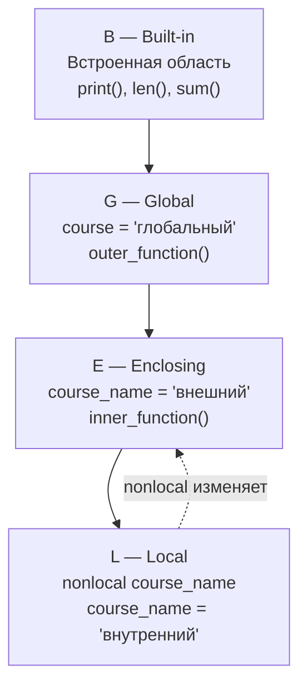
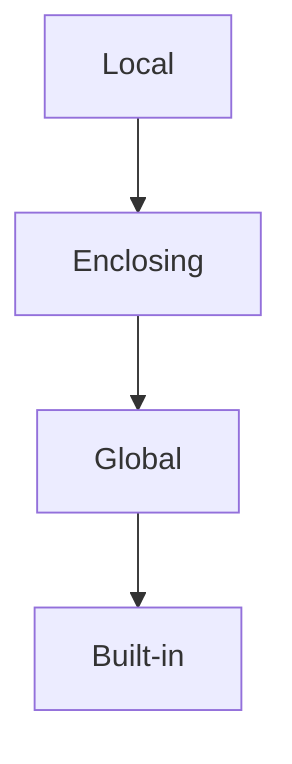

Лабораторная работа № 3. Алгоритмы, коллекции и функции
# 1. Общая информация

Темы курса:

1. Управление потоком выполнения,
2. Базовые алгоритмы, коллекции,
3. Хеширование, функции и области видимости.


# 2. Цель работы

Научиться переводить условие задачи в алгоритм, выбирать подходящую структуру данных и разделять программу на небольшие функции с понятными контрактами.

# 3. Ход работы

## task_1.py:  

Проверены все граничные значения score: 0, 59, 60, 74, 75, 89, 90, 100.

| № | score | work_type | absences | Ожидаемый результат | Фактический результат |
|---:|---:|---|---:|---|---|
| 1 | 0 | exam | 0 | `экзаменационная работа`<br>`недостаточный` | `экзаменационная работа`<br>`недостаточный` |
| 2 | 59 | exam | 0 | `экзаменационная работа`<br>`недостаточный` | `экзаменационная работа`<br>`недостаточный` |
| 3 | 60 | exam | 0 | `экзаменационная работа`<br>`удовлетворительный` | `экзаменационная работа`<br>`удовлетворительный` |
| 4 | 74 | exam | 0 | `экзаменационная работа`<br>`удовлетворительный` | `экзаменационная работа`<br>`удовлетворительный` |
| 5 | 75 | exam | 0 | `экзаменационная работа`<br>`хороший` | `экзаменационная работа`<br>`хороший` |
| 6 | 89 | exam | 0 | `экзаменационная работа`<br>`хороший` | `экзаменационная работа`<br>`хороший` |
| 7 | 90 | exam | 0 | `экзаменационная работа`<br>`отличный` | `экзаменационная работа`<br>`отличный` |
| 8 | 100 | exam | 0 | `экзаменационная работа`<br>`отличный` | `экзаменационная работа`<br>`отличный` |
| 9 | 90 | exam | 4 | `экзаменационная работа`<br>`хороший` | `экзаменационная работа`<br>`хороший` |

Порядок проверки условий:

1. Проверяется `score`: если значение меньше 0 или больше 100, программа печатает `неправильный ввод` и завершается.
2. Читается `work_type`.
3. Читается и проверяется `absences`: допустимы только значения от 0 до 5. При неверном значении программа печатает `неправильный ввод` и завершается.
4. После проверки `absences` выводится тип работы через `match work_type`.
5. Уровень вычисляется по диапазонам score:
   - `90..100` => 4;
   - `75..89` => 3;
   - `60..74` => 2;
   - иначе, то есть `0..59` => 0.
6. Если `absences > 3`, то есть 4 или 5, уровень уменьшается на 1.
7. Итоговый уровень выводится через `match level`:
   - 4 => `отличный`;
   - 3 => `хороший`;
   - 2 => `удовлетворительный`;
   - `x if x < 2` => `недостаточный`.

 Недостижимые ветви:

При текущем порядке условий недостижимых ветвей нет.

Диапазоны score не пересекаются, поэтому порядок `if/elif` не скрывает достижимые варианты:
- `90...100` достижим;
- `75...89` достижим;
- `60...74` достижим;
- `else` для `0...59` достижим.

В `match level`:
- `case 4`, `case 3`, `case 2` достижимы;
- `case x if x < 2` достижим для значений `-1`, `0`, `1`.

Значение `level > 4` невозможно, поэтому эта ветвь отсутствует.

Псевдокод:
```
ФУНКЦИЯ Process(score, work_type, absences):
    ЕСЛИ score вне диапазона 0..100:
        ВЕРНУТЬ сообщение об ошибке

    ЕСЛИ absences вне диапазона 0..5:
        ВЕРНУТЬ сообщение об ошибке

    ПО work_type выбрать название типа работы

    ЕСЛИ score >= 90:
        level = 4
    ИНАЧЕ ЕСЛИ score >= 75:
        level = 3
    ИНАЧЕ ЕСЛИ score >= 60:
        level = 2
    ИНАЧЕ:
        level = 0

    ЕСЛИ absences > 3:
        level = level - 1

    ПРЕОБРАЗОВАТЬ level в текстовую категорию
    ВЕРНУТЬ результат и категорию
```
Время обработки n записей — **O(n)**.
память - **O(1)**.

## task_2.py
Псевдокод:
```
ФУНКЦИЯ binary_search(arr, target):
    lo = 0
    hi = длина(arr) - 1
    comparisons = 0

    ПОКА lo <= hi:
        mid = (lo + hi) // 2
        comparisons = comparisons + 1

        ЕСЛИ arr[mid] == target:
            ВЕРНУТЬ mid и comparisons

        ЕСЛИ arr[mid] < target:
            lo = mid + 1
        ИНАЧЕ:
            hi = mid - 1

    ВЕРНУТЬ -1 и comparisons
```
Время - **O(log n)**.
память - **O(1)**.
## task_3.py

Все структуры обновляются за константное (в среднем) время.

Почему множество подходит для хранения уникальных значений: set хранит элементы в хеш-таблице - при add элемент хешируется, и если такой хеш уже есть, дубликат не добавляется, поэтому уникальность обеспечивается автоматически.

Почему кортеж можно использовать как ключ словаря: Ключ словаря должен быть хешируемым, а хешируемыми могут быть только неизменяемые объекты, при этом кортеж неизменяем, поэтому его хеш стабилен.

Почему Список нельзя использовать как ключ словаря: Список изменяем, поэтому его хеш тоже может изменяться, а хеш ключа должен быть неизменяемым.

Почему словарь предпочтительнее списка для частого поиска результата по составному ключу: В словаре поиск по ключу — O(1) в среднем за счёт хеширования. В списке проход занимает O(n).

### Оценка сложности операций

| Коллекция / операция              | Средняя сложность | Пояснение |
|-----------------------------------|-------------------|-----------|
| `set.add(x)`                      | O(1)              | хеширование + вставка в бакет |
| `x in set`                        | O(1)              | проверка по хешу |
| `list.append(x)`                  | O(1)              | редкое перевыделение массива |
| `x in list` / поиск в списке      | O(n)              | линейный просмотр |
| `dict[key] = value` (вставка)     | O(1)              | хеш ключа + вставка |
| `dict[key]` / `key in dict`       | O(1)              | хеш ключа + поиск в бакете |
| `dict.get(key, default)`          | O(1)              | то же |
| хеширование ключа-кортежа `(a, b)`| O(k) = O(1)       | комбинирование хешей элементов |

### Добавление новой записи (`name, lab, score`)

| Структура   | Операция                                  | Сложность |
|-------------|-------------------------------------------|-----------|
| `students`  | `students.add(name)`                      | O(1)      |
| `labs`      | `labs.add(lab)`                           | O(1)      |
| `attempts`  | `attempts.setdefault(name, []).append(...)` | O(1)    |
| `best`      | проверка `key in best` + возможная запись | O(1)      |
| `counts`    | `counts[key] = counts.get(key, 0) + 1`    | O(1)      |

### Поиск

| Что ищем                                  | Структура  | Сложность |
|-------------------------------------------|------------|-----------|
| Есть ли студент                           | `students` | O(1)      |
| Есть ли лабораторная                      | `labs`     | O(1)      |
| Попытки конкретного студента              | `attempts` | O(1) + O(m) |
| Лучший результат по `(student, lab)`      | `best`     | O(1)      |
| Число попыток по `(student, lab)`         | `counts`   | O(1)      |


## task_4.py

### Области видимости переменных в Python

Схема областей видимости:

## Схема областей видимости (LEGB)



### Объяснение работы nonlocal

В программе объявлена глобальная переменная:

```
course = "глобальный"
```

Во внешней функции создаётся переменная `course_name`:

```
def outer_function():
    course_name = "внешний"
```

Внутри объявляется вложенная функция:

```
def inner_function():
    nonlocal course_name
    course_name = "внутренний"
```

`nonlocal` указывает, что необходимо изменить переменную `course_name` из ближайшей объемлющей (внешней) функции, а не создавать новую локальную переменную,
поэтому после выполнения вложенной функции значение `course_name` во внешней функции тоже изменяется.

Глобальная переменная `course` при этом не изменяется.

### Порядок поиска имён (LEGB)

| Имя | Где объявлено | Где ищется |
|---|---|---|
| `course` | Глобальная область | Global |
| `outer_function` | Глобальная область | Global при вызове |
| `course_name` | Внешняя функция | Enclosing внутри inner_function |
| `inner_function` | Внешняя функция | Local для outer_function |
| `nonlocal` | Ключевое слово Python | Не является именем переменной |
| `print` | Встроенная область | Built-in |

наглядная схема:


Ошибка изменяемого значения по умолчанию:
```
def add_result(value, results=[]):
    results.append(value)
    return results
```
Ошибка: изменяемый объект (список) попал в параметры значения по умолчанию.  
В Python значения параметров по умолчанию вычисляются один раз — в момент определения функции, а не при каждом её вызове.  
Поэтому все вызовы функции без явной передачи results используют один и тот же объект списка. При добавлении новых элементов изменяется общий список, и результаты предыдущих вызовов сохраняются.

Замыкание:
```python
def make_threshold_checker(threshold):
    def check_result(result):
        return result >= threshold

    return check_result

check_50 = make_threshold_checker(50)
```
возвращённая функция check_result сохраняет доступ к переменной threshold из внешней функции. Это замыкание.

## task_5.py

Декомпозиция:

1. Базовые вычисления
```
mean(), min_(), max_(), classify()
```
Выполняют отдельные математические операции и определяют категорию.


2. Анализ данных
```
student_summary(), group_summary()
```
Формируют статистику одного студента и всей группы.


3. Аналитические операции
```
find_top_students()
```
Находит лидеров по среднему результату.


4. Представление результатов
```
format_report(), main()
```
Формируют отчёт и управляют запуском программы.

Контракты:

| Функция | Входные данные | Возвращаемое значение | Особые случаи |
|---|---|---|---|
| `mean(values)` | Последовательность чисел | `float` — среднее | Пустой список → `0.0` |
| `min_(values)` | Последовательность чисел | Минимальное число | Пустой список → `None` |
| `max_(values)` | Последовательность чисел | Максимальное число | Пустой список → `None` |
| `classify(score)` | Число или `None` | Строка с категорией | `None` → «Нет результатов» |
| `student_summary(name, results)` | Имя и последовательность чисел | Словарь со статистикой студента | Пустые результаты → среднее `0.0`, минимум и максимум `None` |
| `group_summary(students)` | Словарь «имя → результаты» | Словарь общей статистики и количества категорий | Пустая группа → нулевые показатели |
| `find_top_students(students)` | Словарь «имя → результаты» | Список имён лидеров | Пустая группа или отсутствие оценок → `[]` |
| `format_report(student_data, group_data)` | Список словарей студентов и словарь статистики | Готовая строка отчёта | Пустые данные → отчёт без студентов и лидеров |

сложность построения общей статистики(group_summary):  
время: O(n+m): n - число студентов, m - число результатов всех студентов.  
память: O(m).


### Выбор коллекций
| Коллекция | Где используется                                                   | Почему выбрана                                                                                            |
| --------- | ------------------------------------------------------------------ | --------------------------------------------------------------------------------------------------------- |
| `list`    | Записи `records`, измерения, попытки, оценки, строки отчёта        | Сохраняет порядок, допускает повторения и удобна для последовательного обхода                             |
| `tuple`   | Одна запись о сдаче; ключ `(student, lab)`                         | Запись компактно объединяет несколько значений; неизменяемый кортеж подходит для составного ключа словаря |
| `set`     | Уникальные студенты и лабораторные работы                          | Автоматически исключает дубликаты; проверка наличия и добавление выполняются за O(1) в среднем            |
| `dict`    | Попытки, лучшие оценки, счётчики, результаты студентов и категории | Позволяет получать значение по ключу в среднем за O(1), удобно моделирует соответствие «ключ → значение»  |

## 4.8. Вывод о влиянии декомпозиции на читаемость

Разделение программы на небольшие функции повысило читаемость и упростило проверку решения. Функции `mean`, `min_`, `max_` и `classify` отвечают за отдельные вычисления; `student_summary` и `group_summary` собирают статистику; `find_top_students` выполняет отдельную аналитическую задачу; `format_report` отвечает за представление данных. Благодаря этому основную логику можно читать по этапам, а ошибки проще проверять отдельными тестами.

Декомпозиция также позволила повторно использовать вычисления и явно описать контракты функций.