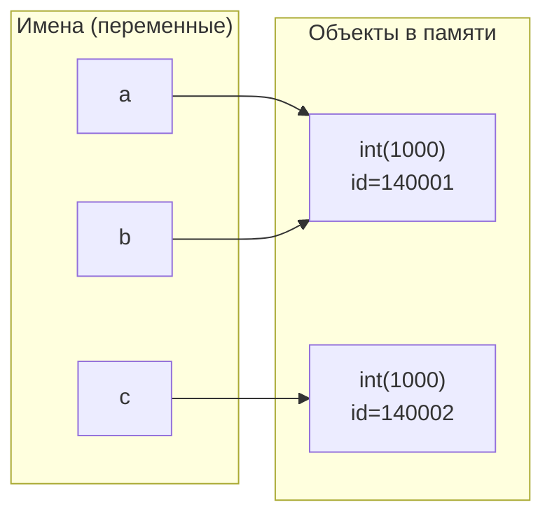

# Лабораторная работа № 1. Выполнение программы, объекты и базовые типы Python

**Цель работы:** разобраться, как CPython выполняет программу, научиться отличать имя от объекта, корректно применять операции сравнения и работать с базовыми типами данных Python.

## Задание №1

### Часть 1

Цикл работы REPL описан в его названии:
- Read - чтение ввода;
- Eval - вычисление;
- Print - вывод результата вычисления на экран;
- Loop - возвращение к началу.

Именно третий шаг работы цикла отвечает за автоматическое отображение результата.

При создание скрипта каждое действие (в том числе вывод) необходимо прописывать вручную, автоматически он не предполагается. Таким образом, чтобы после запуска файла на экран был выведен результат, необходимо добавить команду print().

### Часть 2

```python
course = "Python"  
hours = 4 * 2  
print(f"{course}: {hours} часов")
```

#### Литералы:  
- 'Python' (строковый)
- 4 (целочисленный)
- 2 (целочисленный)
- f'...' (литерал f-строки)

#### Выражения:  
- **'Python'** (вычисляется в строковый объект)
- **4 и 2** (вычисляются в целочисленные объекты)
- **4*2** (арифметическое выражение, вычисляется в 8)
- **{course} и {hours}** (вычисляются в значения, подставляемые в f-строку - 'Python' и 8)
- **f"{course}: {hours} часов"** (f-строка, преобразуется в 'Python: 8 часов')
- **print()** (выражение вызова функции вывода, как выражение возвращает None)

#### Инструкции:
- **course = 'Python'** (инструкция присваивания)
- **hours = 4*2** (инструкция присваивания)
- **print(f"{course}: {hours} часов")** (инструкция вызова функции вывода на экран)


#### Имена: 
- **course** (связано со строкой 'Python')
- **hours** (связано с числовым значением 8)

### Часть 3

**Версия интерпретатора:** Python 3.12.3  
**AST**:
- Присваивание: 
```
Assign(
    targets=[
        Name(id='course', ctx=Store())],
    value=Constant(value='Python'))
```
```
Assign(
    targets=[
        Name(id='hours', ctx=Store())],
    value=BinOp(
        left=Constant(value=4),
        op=Mult(),
        right=Constant(value=2)))
```
- Арифметическая операция:
```
BinOp(
    left=Constant(value=4),
    op=Mult(),
    right=Constant(value=2)))
```
- Вызов print():
```
value=Call(
    func=Name(id='print', ctx=Load()),
    args=[
        JoinedStr(
            values=[
                FormattedValue(
                    value=Name(id='course', ctx=Load()),
                    conversion=-1),
                Constant(value=': '),
                FormattedValue(
                    value=Name(id='hours', ctx=Load()),
                    conversion=-1),
                   Constant(value=' часов')])],
    keywords=[]))]
```

**Дизассемблированный код**

- Нагрузка константы
```
LOAD_CONST               0 ('Python')
LOAD_CONST               1 (8)
20 LOAD_CONST            2 (': ')
26 LOAD_CONST            3 (' часов')
```
- Вызов функции
```
 30 CALL                     1
```

### Контрольный вопрос

Байткод выполняется виртуальной машиной Python (программой-интерпретатором, написанной на C), работает с объектами высокого уровня (строки, списки, функции и тд).  
Машинный код выполняется процессором (физическим устройством), работает с битами, байтами, регистрами процессора.

## Задание №2
### Прогноз:
a == b True  
a is b True  
a == c True  
a is c False

### После запуска:
1.


2. Идентичность означает, что 2 или более переменных ссылаются на один и тот же объект в памяти.  
Равенство означает, что 2 или более объектов имеют одинаковое значение (содержание).
3. c == None
4. В обоих выводах получается True. Объекты действительно равны, т.к. при выполнении 'py' + 'thon' получается 'python', что равно значению первой строки.  
На этапе компиляции 'py' + 'thon' сворачивается в 'python', затем Python интернирует строковые литералы (одинаковые строки становятся одним объектом) и, таким образом, получается, что обе переменные ссылаются на один и то же объект в памяти, что и означает их идентичность.
5. Is лучше использовать в случаях сравнения с None, True, False или когда важно убедиться, что изменение одной переменной так же изменяет другую. В остальных случаях лучше использовать ==.

### Контрольные вопросы

1. Нет, конструкция a = b не создает копию объекта, а ссылается на тот же объект в памяти.
2. type() возвращает тип объекта, id() возвращает уникальный идентификатор объекта (адрес в памяти)
3. None всегда существует в памяти в единственном экземпляре, все переменные с таким значением ссылаются на него. Среди чисел и строк же может существовать множество объектов с одинаковым значением.

## Задание №3
### Эксперимент A. int и арифметические операторы
// - целочисленное деление, возвращающее результат без дробной части, поэтому используется тип int()  
/ - обычное деление, возвращающее результат с дробной частью (даже если она равна 0), поэтому используется тип float()

### Эксперимент B. Большие целые числа
В Python целое число может быть сколь угодно большим, разрядность определяется автоматически, что исключает ошибку переполнения ячейки памяти.  
В большинстве других языков целые числа ограничены определенной разрядностью (например, в C int - 32 бита, long - 64 бита). Поэтому при введении числа, выходящего за пределы заданной разрядности, возникает ошибка переполнения.

### Эксперимент C. float
Не все десятичные дроби можно представить в виде конечной дроби в двоичной системе. То же касается и чисел 0.1 и 0.2. Именно из-за применяемого округления в результате выражения 0.1 + 0.2 получается не 0.3, а 0.30000000000000004.  
Сравнивать числа с плавающей точкой рекомендуется не через ==, требующее абсолютного совпадения, а через функцию math.isclose(), проверяющую находится ли разница между числам в пределах допустимой погрешности (что позволяет пренебречь последствиями округления при переводе в двоичную систему и обратно).

### Эксперимент D. bool, complex и явное преобразование типов.
bool("False") дает истинное значение, потому что false написано в кавычках, соответственно, pyhton не смотрит на содержание строки, а лишь видит, что она не пустая, что и равняется логической единице (истине).  
Для вывода действительной и мнимой частей комплексного числа используются аргументы .real и .imag.

### Контрольные вопросы
1. Для избежания потери точности Python автоматически изменяет тип результата на float. Например, 5/2 = 2.5 (тип int физически не может хранить число с плавающей точкой, поэтому во избежание потери точности результат сохраняется как float).
2. int('42') - это парсинг строки. Python берет текстовую строку и пытается преобразовать ее символы в целое число.  
int(42.9) - округление к 0. Python берет заданное число и отбрасывает дробную часть (например, int(42.9) дает в результате 42, а int(-42.9) дает -42).
3. Falsy - значения, оценивающиеся как false.  
bool(0)  
bool("")

## Задание №4
6. Получение необходимой строки:
```python
print('%s - %s: %d/%d (%.1f%%)' % (student, course, completed, total, (completed/total)*100))
print('{} - {}: {}/{} ({:.1f}%)'.format(student, course,completed, total, (completed/total)*100))
print(f'{student} - {course}: {completed}/{total} ({completed/total*100}%)')
```
8. Сообщение об ошибке:
```
Traceback (most recent call last):
  File "/home/shusss/Документы/ITMO/прога/lab_01/task_4.py", line 17, in <module>
    student[0] = 'И'
    ~~~~~~~^^^
TypeError: 'str' object does not support item assignment
```
В Python строки являются неизменяемыми объектами, поэтому при внесении любых изменений (например, s = s + '!') Python не меняет исходную строку, а создает новую. Таким образом, и через индекс строку изменить не получится.

### Контрольные вопросы
1. len(symbol) считает количество символов в строке, а len(symbol.encode("utf-8")) считает количество байт, занимаемое данной строкой. Разные символы закодированы разным количеством байт (например, латиница и цифра занимают по 1 байту, а кириллица - 2 байта), поэтому значения len(symbol) и len(symbol.encode("utf-8")) могут различаться.
2. В записи text[start:stop:step] start означает индекс первого символа, входящего в срез, stop означает первый символ не входящий в срез (индекс последнего входящего символа +1), а step означает шаг через сколько элементов брать (не может быть равен 0)
3. При применении методов Python не изменяет исходную строку, а создает новую с измененным содержимым и возвращает её

## Задание №5
1. имя исследователя: <class 'str'>  
название эксперимента: <class 'str'>  
количество выполненных запусков: <class 'int'>  
длительность одного запуска в секундах: <class 'float'>  
действительная часть комплексного коэффициента: <class 'float'>  
мнимая часть комплексного коэффициента: <class 'float'>
2. Cтрока: `mtime = stime/60`  
литерал: 60  
имена: mtime, stime  
операторы: присваивание (=), деление (/)  
функции: отсутствуют
3. Исходный файл - текстовый файл .py, содержащий код на языке Python  
Токенизация - интерпретатор разбивает исходный текст на минимальные смысловые единицы (токены): имена, ,числа, операторы, литералы.  
AST - парсер преобразует поток токенов в абстрактное синтаксическое дерево (AST), отображающее иерархическую структуру программы.  
Компиляция в байткод - компилятор CPython обходит AST и генерирует последовательность простых команд — байткод, предназначенный для выполнения виртуальной машиной.  
Выполнение виртуальной машиной CPython - интерпретатор последовательно читает байткод, используя стек для промежуточных вычислений, вызывает встроенные функции и выполняет операции ввода-вывода.
4. По умолчанию данные, введенные через input(), относятся к строковому типу данных (str), поэтому для выполнения арифметических операций необходимо явно их преобразовать в целочисленный или вещественный типы.

### Контрольный вопрос
После повторного присваивания значения уже существующему объекту Python создает в памяти новый объект, на который ссылается заданная переменная, а старый удаляет.

## Вывод. Неожиданные особенности Python:
- необходимость использования функции math.isclose() для сравнения вещественных чисел из-за округления при переводе чисел в двоичную систему и обратно;
- кэширование, из-за которого результаты применения оператора is не всегда могут показаться очевидными (например, при a = 100 и b = 100 выражение a is b даст в результате True);
- Python, в отличие от большинства других языков, сам определяет необходимое место для значений типа int, не имея фиксированной разрядности.
