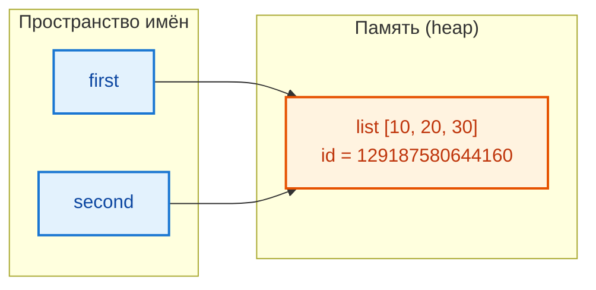
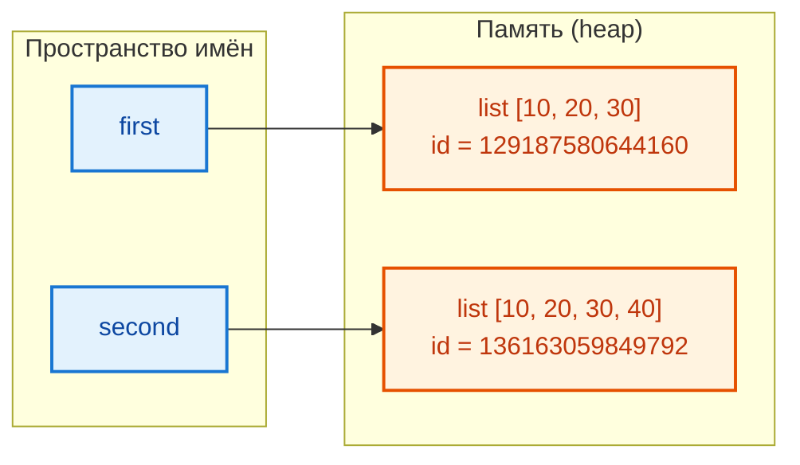
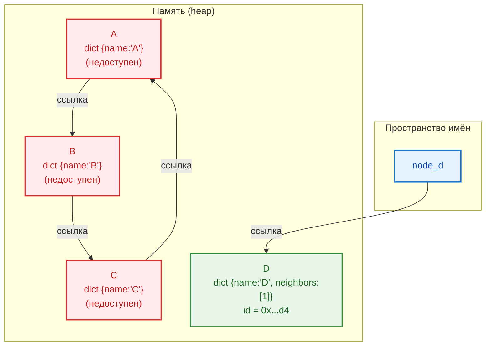

# Лабораторная работа № 2. Управление объектами и памятью в Python

**Цель работы:** исследовать связь между именами и 
объектами, понять различия между присваиванием, поверхностным 
и глубоким копированием, а также познакомиться с механизмами 
управления памятью в CPython.

## Задание 1. Имена, ссылки и изменяемость
### Эксперимент A. Неизменяемый объект
В Python переменные являются ссылками на объект в памяти, 
а не самими ячейками памяти, поэтому при задании значения 
переменной b, она просто стала ссылаться на тот же объект, 
на который ссылалась переменная a. Поскольку числа являются 
неизменяемыми объектами, при изменении значения a была создана
новая ячейка памяти со значением 11. Это не повлекло за собой 
изменение b, т.к. она все еще ссылается на ячейку, хранящую 10.

### Эксперимент B. Изменяемый объект
Списки в Python являются изменяемыми объектами. 
При изменении значения первого списка, новый не создается, 
изменения происходят в текущем, поэтому это влечет за собой 
и изменение значения связанного с ним второго списка.

### Дополнение программы
```python
second = [10, 20, 30]
print(f'second == first: {second == first}')
print(f'second is first: {second is first}')
second.append(40)
print(first)
```
Вывод: 
```python
second == first: True
second is first: False
[10, 20, 30]
```

Оператор == сравнивает значения, лежащие в списках, поэтому выдает истину. 
Оператор is проверяет ссылаются ли переменные на один объект в памяти. 
Второму списку было задано значение, не связанное с первым, поэтому они ссылаются на разные ячейки памяти и 
при применении оператора is выводится ложь.

#### Схема до переназначения


#### Схема после переназначения



### Практическое задание
Вывод:
```python
До изменений:
  config_1: {'name': 'Task Tracker v1.0', 'participants': ['Иванов', 'Петров'], 'launch_params': {'host': 'localhost', 'port': 8080, 'debug': False}}
  config_2: {'name': 'Task Tracker v1.0', 'participants': ['Иванов', 'Петров'], 'launch_params': {'host': 'localhost', 'port': 8080, 'debug': False}}

После изменений в config_2 (простое присваивание):
  config_1: {'name': 'Task Tracker v2.0', 'participants': ['Иванов', 'Петров', 'Сидоров'], 'launch_params': {'host': 'localhost', 'port': 9090, 'debug': True}}
  config_2: {'name': 'Task Tracker v2.0', 'participants': ['Иванов', 'Петров', 'Сидоров'], 'launch_params': {'host': 'localhost', 'port': 9090, 'debug': True}}

До изменений (deepcopy):
  config_1: {'name': 'Task Tracker v1.0', 'participants': ['Иванов', 'Петров'], 'launch_params': {'host': 'localhost', 'port': 8080, 'debug': False}}
  config_2: {'name': 'Task Tracker v1.0', 'participants': ['Иванов', 'Петров'], 'launch_params': {'host': 'localhost', 'port': 8080, 'debug': False}}

После изменений в config_2 (deepcopy):
  config_1: {'name': 'Task Tracker v1.0', 'participants': ['Иванов', 'Петров'], 'launch_params': {'host': 'localhost', 'port': 8080, 'debug': False}}
  config_2: {'name': 'Task Tracker v2.0', 'participants': ['Иванов', 'Петров', 'Сидоров'], 'launch_params': {'host': 'localhost', 'port': 9090, 'debug': True}}

```

Из выводов выше ясно, что при простом присваивании создается 
новая ссылка на тот же объект в памяти. При использовании deepcopy 
словари копируются рекурсивно, что позволяет обеспечить независимость 
конфигураций.

### Вопросы для анализа
1. Присваивание second = first не меняет сам объект, а лишь создает новую ссылку на него.
2. По определению неизменяемого типа в модели данных Python, после создания объекта его 
значение изменить невозможно. Поэтому при таком "изменении" фактически
в памяти создается новый объект, на который теперь ссылается переменная.
3. Определить, что два имени обозначают один объект позволяет оператор is, 
проверяющий равенство id объектов в памяти.

## Задание 2. Поверхностное и глубокое копирование
| Операция | Новый внешний объект | Новые вложенные объекты |                                            Изменения независимы                                             |
|----------|:--------------------:|:-----------------------:|:-----------------------------------------------------------------------------------------------------------:|
| Присваивание (=) |          -           |            -            |                                    Любое изменение видно через оба имени                                    |
| Поверхностная копия (.copy()) |          +           |            -            | Частично: `append`/`pop` на внешнем списке независимы, но изменения вложенных объектов видны во всех копиях |
| Глубокая копия (copy.deepcopy()) |          +           |            +            |                                            Все уровни независимы                                            |

### Исследование ошибочного создания матрицы
При создании матрицы копированием одной строки изменение одного объекта одной строки ведет 
к изменению соответствующих объектов других строк, поскольку матрица фактически состоит 
не их 3х независимых строк, а из 3х ссылок на одну и ту же строку.

При создании матрицы через генератор каждая строка независима, поэтому 
изменение элементов одной строки не влечет изменение соответствующих элементов 
других строк.

### Вопросы для анализа
1. Поверхностная копия (.copy()) создает новый объект верхнего уровня, но его содержимое 
заполняется ссылками на те же вложенные объекты, что и у оригинала.  
Глубокая копия рекурсивно обходит всю структуру и создает копию каждого 
вложенного объекта. В результате копия полностью независима от оригинала, исключаются 
общие ссылки на объекты.
2. Причины неэффективности применения глубоких копий для всех объектов:
- уменьшение производительности (рекурсивный обход больших массивов данных занимает большое количество времени и памяти), особенно при наличии циклических ссылок;
- объекты с ссылками на внешними ресурсами не копируются корректно;
- избыточно при работе с неизменяемыми типами данных.
3. Случаи, в которых достаточно поверхностной копии:
- вложенные объекты не изменяемы;
- необходима и достаточна изоляция только на верхнем уровне;
- важна высокая производительность.

## Подсчет ссылок и время жизни объекта
- Функция sys.getrefcount() сама получает объект как аргумент. 
При передаче аргумента в функцию Python создаёт временную ссылку 
на объект, что и увеличивает счётчик.
- Счётчик увеличивают присваивание, помещение в контейнер, передача в функцию
в качестве аргумента, возврат из функции, распаковка.
- Счётчик уменьшают удаление имени (del), выход из области видимости (завершение функции, закрытие блока с with), 
удаление из контейнера, перенаначение имени, завершение программы.
- del в Python — это оператор разыменования имени, 
а не команда удаления объекта из памяти. Он только убирает имя из 
текущего пространства имён (объект при этом не удаляется напрямую). 
Если на объект есть еще другие ссылки, он продолжает жить в памяти, иначе уничтожается.

### Слабые ссылки
Слабая ссылка (weakref.ref) — это ссылка, которая не увеличивает 
счётчик ссылок объекта. Сборщик мусора при принятии решения об 
уничтожении объекта игнорирует слабые ссылки. Как только последняя 
сильная ссылка на объект исчезает, объект уничтожается, а все слабые 
ссылки на него автоматически "ослабевают" — начинают возвращать 
None при вызове.

Пример:
- если в программе используются тяжелые объекты (http-запрос к внешнему API, результаты SQL-запросов), 
бывает удобно их кэшировать. Но в таком случае они будут "жить" (и занимать место в кэше) 
все время работы программы, поэтому здесь выгодно использовать слабые ссылки (кэш очистится сразу, как на объекты перестанут ссылаться).

### Практическое задание
Программа на практике доказала, что слабый реестр не управляет временем жизни зарегистрированных объектов.

### Вопросы для анализа
1. Объект удаляется, когда счётчик ссылок становится равен 0 (слабые ссылки не учитываются).
2. В CPython используется пульный аллокатор pymalloc (для объектов размером <= 512 Б).
Python запрашивает у ОС арены памяти по 256 КБ и сам управляет памятью внутри этих блоков. Обратно ОС память возвращается только в том случае, когда целая арена освобождается.
3. Наличие сильной ссылки не позволяет удалить объект, в отличие от слабой, которая не учитывается в счётчике.

## Задание 4. Циклические ссылки и сборщик мусора
После удаления first и second в памяти остаются 2 списка, бесконечно ссылающихся друг на друга.
Для каждого списка refcount = 1, но, поскольку к ним не ведет ни одно имя из поля имен, они считаются недостижимыми (изолированный цикл). Для обнаружения таких ситуаций и нужен сборщик мусора.

**Назначение поколений сборщика мусора:**
- Поколение 0: все новые объекты, которые могут быть отслежены сборщиком (списки, словари, пользовательские объекты). Сборка 0 поколения происходит чаще всего, т.к. объектов мало.
- Поколение 1: все объекты, пережившие 0 сборку.
- Поколение 2: объекты, пережившие несколько сборок. Запускается наиболее редко, т.к. объектов много и большинство из них действительно живы.
Именно разделение на поколения позволяет добиваться максимальной эффективности сборки: вместо того чтобы каждый раз обходить все объекты в памяти (что дорого), сборщик чаще всего проверяет только поколение 0 — там мало объектов, и большинство из них — мусор.

### Практическое задание
Схема созданного графа:

### Вопросы для анализа
1. Циклическая ссылка возникает, когда два или более объекта ссылаются друг на друга (напрямую или через цепочку промежуточных объектов), образуя замкнутый контур.
2. Объект с ненулевым счётчиком ссылок иногда может быть недостижим из программы, 
потому что refcount считает все ссылки, в том числе и от объектов, которые сами могут быть недостижимы.
3. Сборщик мусора разделяет отслеживаемые объекты по поколениям для оптимизации: частые дешёвые сборки младших поколений быстро убирают основной мусор, а долгоживущие объекты не тратят время сборщика на постоянные проверки.

## Задание 5. Исследование потребления памяти
### Часть 1. Размер отдельных объектов
Размер контейнера не обязательно включает полный размер всех объектов, на которые он ссылается, 
потому что при использовании `sys.getsizeof()` возвращается размер самого контейнера, 
хранящего только ссылки на содержащиеся в нем объекты. Все содержащиеся объекты при этом рекурсивно не объодятся.

### Часть 2. Рост списка
- Размер списка увеличивается не после каждого `append()`, а "скачками", когда заканчивается заранее выделенное с запасом место.
- Список резервирует место с запасом, чтобы избежать частых запросов на выделение памяти (дорогая по времени операция).
- Длина списка - это количество его элементов, а объем выделенной памяти - это размер памяти, занимаемой ссылками на эти самые элементы.

### Часть 3. Измерение через tracemalloc
Материализованная последовательность представляет собой список из n элементов, каждый из которых хранится в целочисленном типе (в данном случае), что занимает большой объем памяти.

Правило получения значений хранится как один объект, хранящий только значения start, stop, step, а элементы последовательности, занимающие большой объем памяти, генерируются только при обращении.

### Итоговый анализ
Способы уменьшения лишнего потребления памяти в программах, работающих с большими объемами данных:
- использовать правила задания последовательностей, вместо материализованных (задание 5, часть 3), но важно учитывать, что не подходит при необходимости иметь доступ к срезам, доступ к элементам по индексам;
- использовать слабые ссылки для кэшей (задание 3, часть 3), но не имеет смысла при необходимости поддерживать жизнь объекта вне зависимости от его использовании, при работе с легковесными данными;
- избегать излишнего глубокого копирования (задание 2), если вложенные объекты неизменяемы, нужна независимость только на верхнем уровне, во вложениях есть специфические для deepcopy типы данных.
